# Debugging in PyCharm

| File | It | But |
| --- | --- | --- |
| `average_bug.py` | work out each student's average | everyone after the first student gets the wrong average |
| `grade_bug.py` | give each student a letter grade | one student gets the wrong letter |

## Three things to know first

- **Breakpoint:** click just to the right of a line number to add a red dot. The program will pause there. Click the dot again to remove it.
- **Use Debug, not Run.** Run ignores breakpoints. Debug is the bug icon next to Run.
- **The highlighted line hasn't run yet.** When PyCharm pauses, the blue line is the one it's *about* to run.

The buttons are in the Debug panel at the bottom of the window. If you forget what one does, see the [cheat sheet](#cheat-sheet) at the end.

---

## Example 1: `average_bug.py`

Star's average is right but Bob's is wrong, so something breaks when the loop moves from one student to the next. To see it, pause at the start of the loop and step through.

**1. Pause at the loop.** Put a breakpoint on line 11 (`for name, marks in scores.items():`) and press **Debug**.

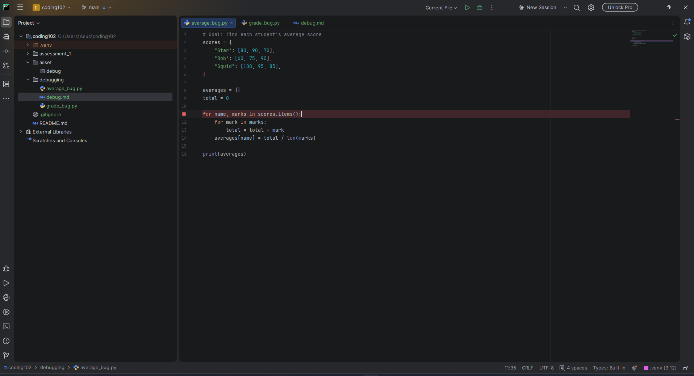

The program stops on line 11. The Variables panel (bottom right) shows `scores`, `averages`, and `total = 0`.

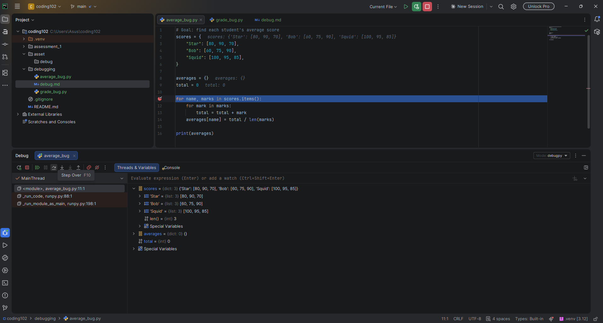

**2. Step through Star.** **Step Over** runs one line and then pauses again. Press it twice and you're on line 13 with `mark = 80`. `total` is still `0`, because line 13 hasn't run yet.

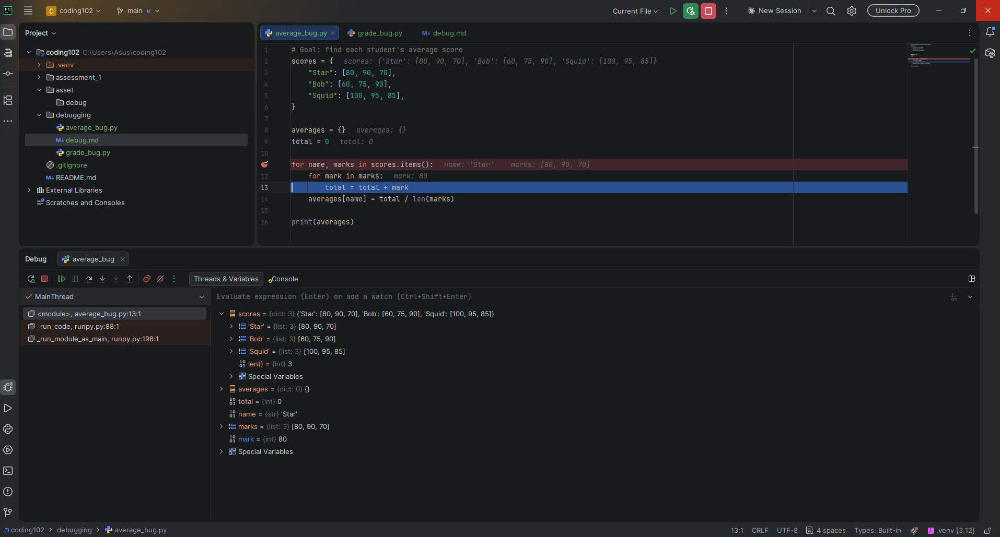

Keep pressing **Step Over** and watch `total` go up: 80, 170, 240.

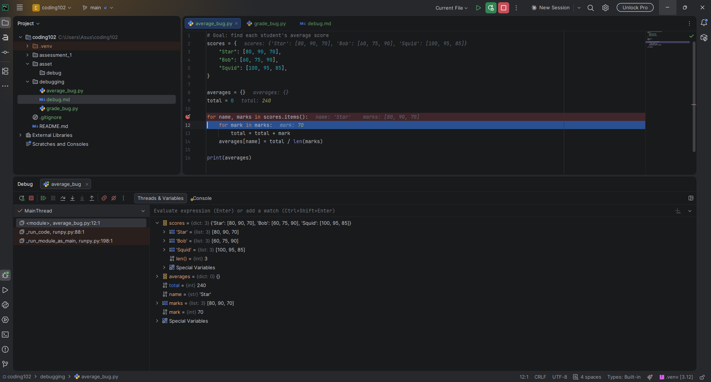

A couple more steps and `averages` is `{'Star': 80.0}`. That's correct: (80 + 90 + 70) / 3 = 80.

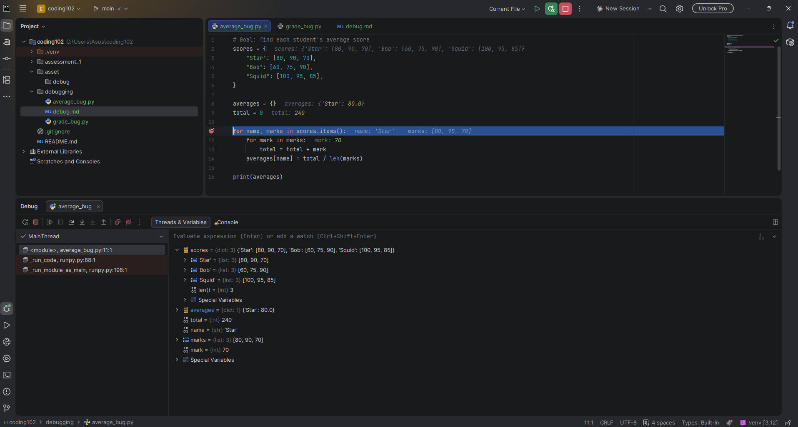

**3. Watch Bob start.** Keep stepping into Bob's turn. Before his first mark is added, check `total`:

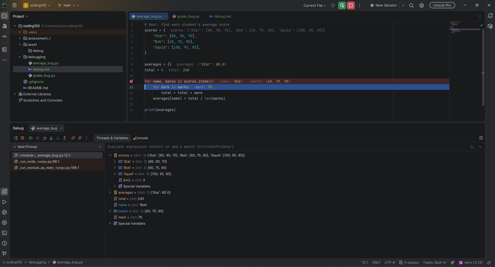

It's still 240, left over from Star. Bob ends up with `155.0` when his real average is 75.0.

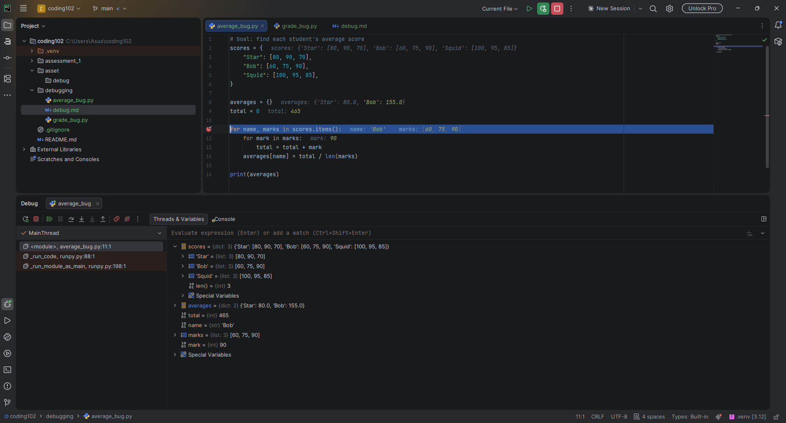

That's the bug: `total = 0` runs only once, before the loop starts, so nothing resets it for the next student.

<details>
<summary><b>How to fix it</b> </summary>

Move `total = 0` inside the outer loop, just before `for mark in marks:`. Run Debug again and check that `total` is 0 when Bob's turn starts. You should get:

```
{'Star': 80.0, 'Bob': 75.0, 'Squid': 93.33333333333333}
```

</details>

---

## Example 2: `grade_bug.py`

This time the work happens inside functions, so you'll need **Step Into** and **Step Out**.

The comment at the top says 80 and above is an A. Star's average is 80, but Star gets a B.

**1. Step Over skips the inside of a function.** Put a breakpoint on line 30 (`avg = average(marks)`) and press **Debug**. Press **Step Over**. `average()` runs all at once and you only see the result, `avg = 80.0`.

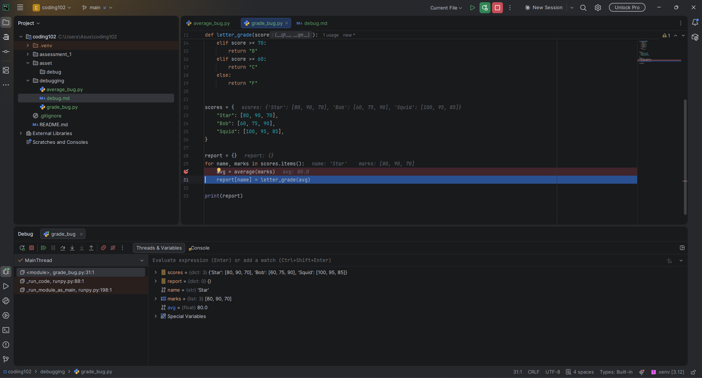

Step Over once more and `report` is `{'Star': 'B'}`. That's wrong, but from out here you can't see why.

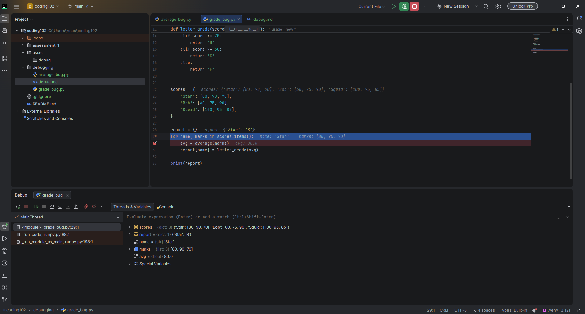

**2. Step Into takes you inside.** Keep going until you're back on line 30 for Bob. The grey `avg: 80.0` is Star's old value, left over because line 30 hasn't run yet for Bob.

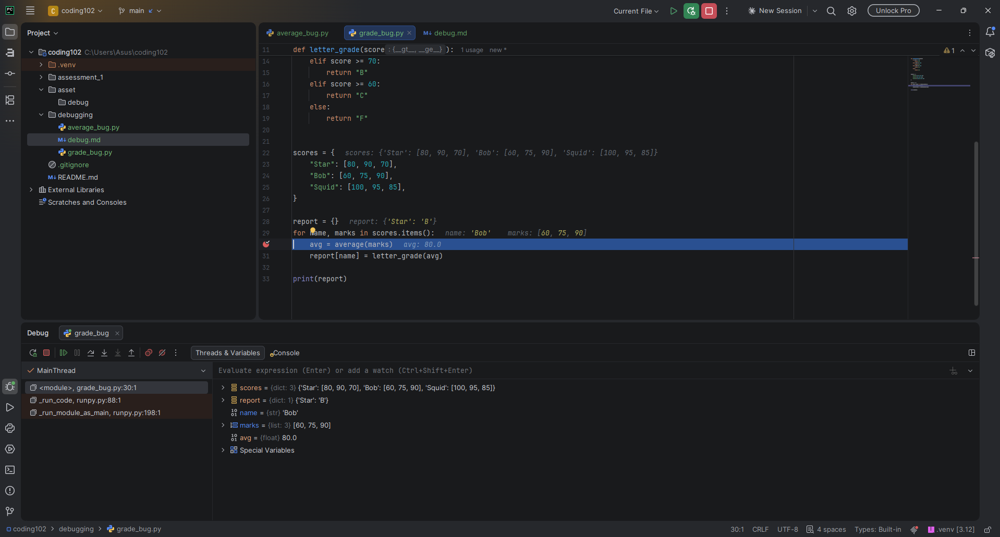

Now press **Step Into**. You're on the first line of `average()`. In the Frames panel (bottom left), `average` is on top of `<module>`, which means you're inside `average()`, called from the main program.

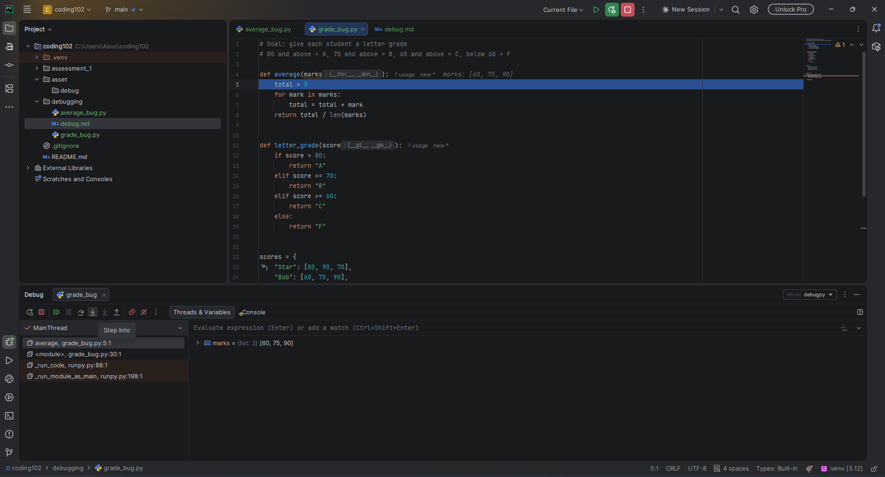

Step Over through the loop until you reach `return`. `total` is 225.

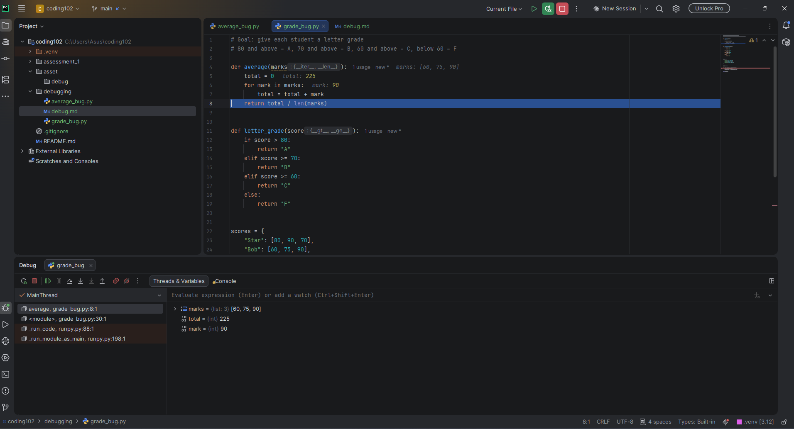

One more step and you're back on line 30 with `avg = 75.0`.

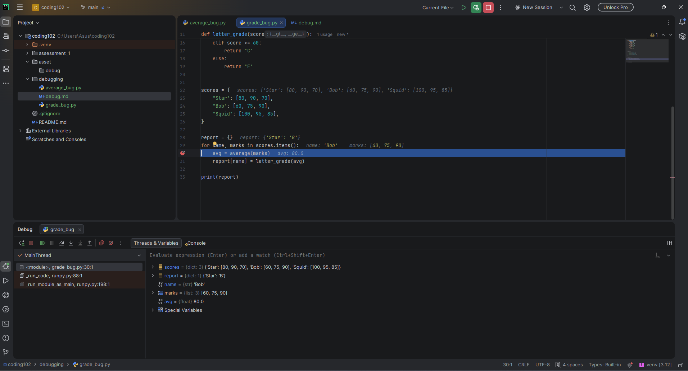

**3. Step Out gets you back out.** Press **Step Into** on line 31 to go inside `letter_grade()` with `score = 75.0`.

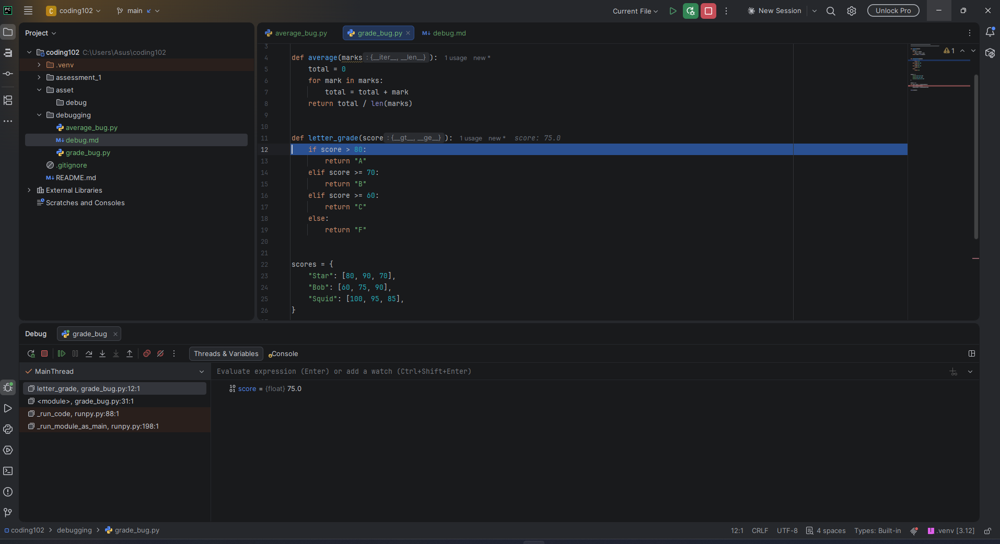

Step once. `75 > 80` is False, so it moves on to check `score >= 70`.

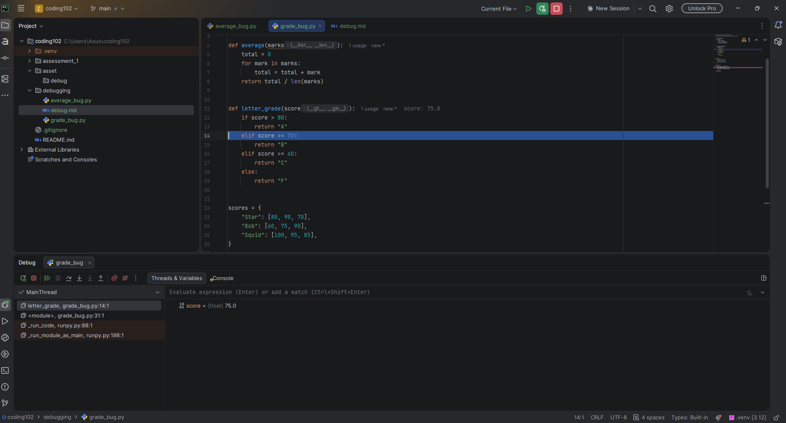

If you've seen enough, press **Step Out**. The rest of the function still runs, just without pausing, and you're back on line 31.

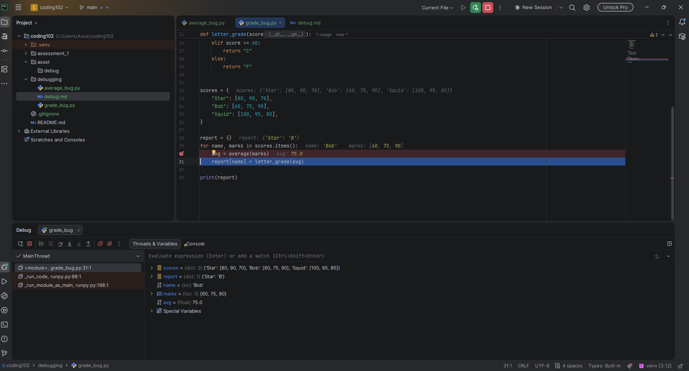

<details>
<summary><b>How to fix it</b> </summary>

On line 12, `score > 80` means "more than 80", so exactly 80 doesn't count. Change it to `score >= 80`. You should get:

```
{'Star': 'A', 'Bob': 'B', 'Squid': 'A'}
```

</details>

---

## Cheat sheet

| Button | What it does |
| --- | --- |
| **Step Over** | Runs the current line and pauses on the next one. A function call runs all at once. |
| **Step Into** | If the line calls one of your functions, goes inside it. |
| **Step Out** | Runs the rest of the current function and pauses where it was called. |
| **Resume** | Keeps running until the next breakpoint, or to the end. |
| **Stop** | Ends the debug session. |

- **Variables** (bottom right): every variable that exists right now. Click `>` to look inside lists and dicts.
- **Inline values** (grey text in your code): the current values, shown right next to the code.
- **Frames** (bottom left): which function you're in. The top entry is where you are now.
